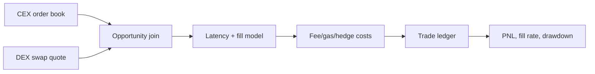

# CEX-DEX Cross-Venue Arbitrage & Execution Simulator

A latency-aware replay engine that joins a CEX quote with a DEX execution quote and computes executable, cost-adjusted PnL. Fees, gas, hedge cost, latency slippage, and failed fills are modeled explicitly.

## Architecture


## Structural overview
`src/arb_simulator/sim.py` contains quote joining, execution-cost modeling, and aggregation; `cli.py` runs a replay; `tests/` verifies failure and metric behavior.

## Workflow
1. Create synchronized CEX/DEX quotes.
2. Reject opportunities whose gross edge cannot cover costs.
3. Apply latency-dependent slippage and stochastic fill failure.
4. Record a ledger row for every attempted trade.
5. Aggregate net PnL, fill rate, Sharpe-like score, and max drawdown.

## Why this approach
A backtest that ignores failed fills or gas only measures theoretical spread. The ledger is intentionally loss-aware so a positive gross edge can still produce negative net performance.

## Run
```bash
pip install -e .
python -m arb_simulator.cli --output reports/arbitrage-summary.json
pytest -q
```

The CLI writes a JSON summary when `--output` is provided. A production adapter should normalize CEX order-book snapshots and DEX quote responses into `Opportunity` records.

## Environment

`BinanceTestnetClient` reads `BINANCE_TESTNET_API_KEY` and `BINANCE_TESTNET_BASE_URL` when present. Public depth endpoints are used by default; authenticated trading is deliberately outside this read-only research adapter.

## Live adapter boundary
`arb_simulator.binance.BinanceTestnetClient` provides a read-only Binance Spot Testnet depth adapter. Convert its best bid/ask into an `Opportunity` alongside a DEX quote; no API key is needed for public depth in most environments.

### Credential-dependent blockers
Live cross-venue replay requires Binance testnet reachability and a DEX quote adapter. Order-book queue position, private order flow, and settlement confirmation are outside this offline core.

## Limitations
The fixture does not model private order flow, exchange queue position, or chain reorgs. Add venue adapters and historical snapshots before production use.
