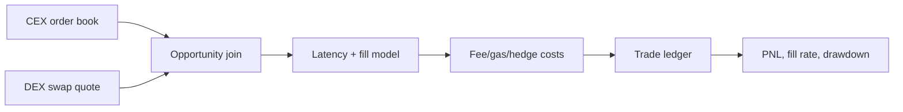

# CEX-DEX Cross-Venue Arbitrage & Execution Simulator

A latency-aware replay engine that joins a CEX quote with a DEX execution quote and computes executable, cost-adjusted PnL. Fees, gas, hedge cost, latency slippage, and failed fills are modeled explicitly.

## Architecture


## Workflow
1. Create synchronized CEX/DEX quotes.
2. Reject opportunities whose gross edge cannot cover costs.
3. Apply latency-dependent slippage and stochastic fill failure.
4. Record a ledger row for every attempted trade.
5. Aggregate net PnL, fill rate, Sharpe-like score, and max drawdown.

## Why this approach
A backtest that ignores failed fills or gas only measures theoretical spread. The ledger is intentionally loss-aware so a positive gross edge can still produce negative net performance.

## Run
```bash
pip install -e .
python -m arb_simulator.cli
pytest -q
```

## Limitations
The fixture does not model private order flow, exchange queue position, or chain reorgs. Add venue adapters and historical snapshots before production use.
