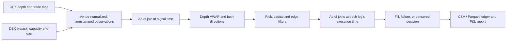
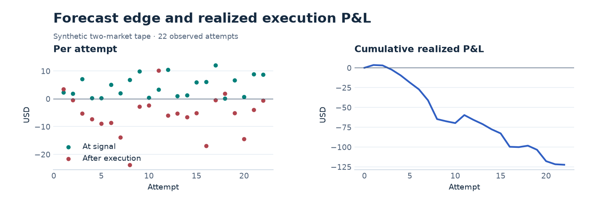

# CEX–DEX Cross-Venue Arbitrage & Execution Simulator

Replay cross-venue spreads from timestamped CEX books and DEX quotes. Evaluate the expected signal separately from the observed execution outcome, including latency, depth, fees, hedging and paid gas.

## Run a replay

Requires Python 3.11 or later.

```bash
python -m pip install -e '.[test]'
cex_dex_arbitrage_simulator --write-tape reports/demo-tape.json \
  --ledger reports/demo-ledger.parquet --output reports/demo.json
cex_dex_arbitrage_simulator --input reports/demo-tape.json \
  --ledger reports/replay.csv --output reports/replay.json
python -m pytest -q
```

Supply `--config data/config.json` to vary position size, capital, latency, quote age, fee budgets, hedge costs and the cost of a failed attempt. With Docker, build the image and pass the same options to the container entry point.

## Architecture



| Component | Responsibility |
|---|---|
| `tape.py` | Validates market pairs, unique timestamps per stream, quote capacity, and optional market observation end time. |
| `binance.py` | Normalizes sorted book levels, aggregates duplicate prices, checks crossed books and computes executable VWAP. |
| `replay.py` | Builds causally available signal quotes, sizes by a fixed research quantity, rechecks depth at modeled execution, and records decisions. |
| `cli.py` | Imports or exports tapes, captures Spot Testnet depth and writes JSON, CSV or Parquet. |

## Tape and timing contract

Each row contains `market` and `time_ms`. Use one common clock across venues and one common USD-equivalent quote unit per market.

| Stream | Required fields |
|---|---|
| `books` | `bids` and `asks` as `[price, quantity]` levels. An optional `update_id` tracks source sequence. |
| `dex_quotes` | `bid`, `ask`, `max_qty`, `gas_usd`. An optional `impact_bps_per_unit` models quote movement with order size. |
| `cex_trades` | Optional `price` and `quantity` rows for observed trade count and notional by market. |

The decision uses only snapshots at or before its timestamp. The simulated fill uses the most recent eligible quote observed by each leg's own execution timestamp and rejects quotes older than `max_quote_age_ms`. An attempt is censored when either execution timestamp exceeds `observed_through_ms` or the common observed window. Captured trades provide diagnostics in the report.

## Execution and risk accounting

- Each simulated direction consumes full CEX depth as VWAP and uses the DEX capacity/impact model. The capital budget is split by market. A market has one pending attempt at a time.
- Fill P&L is sell proceeds less buy costs, execution fees, hedge fees and gas. A modeled failed attempt pays the configured fraction of DEX gas. Edge decay is expected signal P&L minus realized attempt P&L.
- Fill rate uses observed attempts as its denominator. Drawdown includes the starting equity point. The Sharpe-like figure uses irregular, per-attempt outcomes and has no annualization.
- The simulator models fill-or-kill execution with prefunded inventory and an explicit hedge cost. Real two-venue operations can introduce legging, settlement, queueing and funding risk beyond that model.

## Capture a real order-book snapshot

The read-only capture uses the Binance Spot Testnet depth endpoint and writes a normalized `books` element. The timestamp is the local receipt time. Capture quotes with a synchronized clock and preserve the original feed metadata when assembling a historical tape.

```bash
cex_dex_arbitrage_simulator --capture-book ETHUSDT --market ETH-USDT --output reports/binance-book.json
```

[Binance Spot Testnet](https://testnet.binance.vision/) · [Binance market-data endpoints](https://developers.binance.com/docs/binance-spot-api-docs/rest-api/market-data-endpoints)

## Reproduced demo results

The seeded two-market tape generates 22 observed attempts and 19 fills. It realizes −$122.40 after costs from the default assumptions, with a maximum drawdown of $125.89.


